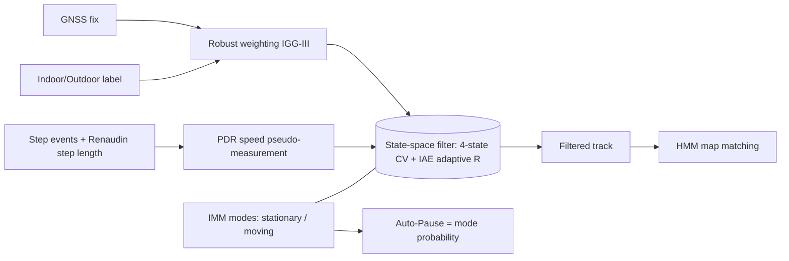

# Aetron — MỘT hướng nghiên cứu thống nhất: Context-Aware Recursive Bayesian Estimation for Indoor and Outdoor Activity Tracking
Quyết định (2026-11-27, theo yêu cầu chủ dự án): **Ước lượng trạng thái Bayes đệ quy (họ Kalman) cho theo dõi vận động bằng điện thoại.** Mọi thuật toán Aetron là một thành phần của cùng một mô hình state-space; không còn thuật toán rời rạc/heuristic nằm ngoài khung này. Phạm vi: GNSS, dừng/Auto-Pause, bước, cadence, độ dài bước, indoor/outdoor, route matching.

## 1. Luận đề
> Fitness tracking trên điện thoại là bài toán ước lượng trạng thái x_t = [vị trí, vận tốc, (chế độ chuyển động)] từ quan sát nhiễu không đồng bộ (GNSS, bước/PDR, môi trường). Mỗi quyết định (lọc outlier, dừng, bước, vị trí) là suy luận xác suất trong cùng bộ lọc, có kiểm định nhất quán bằng innovation.

## 2. Khung và bản đồ thành phần

| Thành phần | Vai trò trong khung | Bài báo nền | Loại |
|---|---|---|---|
| Bộ lọc nền | Kalman 4-state CV | [K60] Kalman 1960, 10.1115/1.3662552 | Definition |
| Kháng outlier GNSS | Trọng số quan sát | [Y01] 10.1007/s001900000157 | Faithful |
| Thích nghi nhiễu | R̂ từ innovation | [MS99] 10.1007/s001900050236 | Adaptation |
| Dừng / Auto-Pause | Mô hình *stationary* vs *moving* trong IMM; dừng = P(stationary) | [BB88] Blom & Bar-Shalom, IEEE TAC 33(8):780–783, 10.1109/9.1299 | Adaptation |
| Bước/PDR vào bộ lọc | Quan sát vận tốc = độ dài bước × cadence | [S18], [X22] bước; [R12] Renaudin 2012, 10.3390/s120708507 độ dài bước; tích hợp GNSS/PDR EKF: Gyroscopy & Navigation 2020, 10.1134/S2075108720020054 (S0: đọc để lấy mô hình đo) | Adaptation |
| Indoor/Outdoor | Quyết định tin/không tin GNSS (thay R / bỏ cập nhật GNSS) | [D24] 10.3390/s24165125 (fallback [L14]) | Faithful hoặc NOT REPRODUCED |
| Route matching | Hậu xử lý quỹ đạo đã lọc | [NK09] 10.1145/1653771.1653818 (HMM, cùng họ Bayes) | Faithful |
| Kcal | Hậu xử lý | Compendium 2024 | giữ nguyên |

## 3. Khai báo trung thực (không được giấu)
1. **Từng bài** được tái hiện/điều chỉnh đúng như cột "Loại". Việc *ghép* chúng thành một khung là kiến trúc của Aetron, **không phải một bài báo đã công bố** — không được gọi là "reproduction của khung". Đóng góp luận văn = khung thống nhất + đánh giá ablation (từng thành phần bật/tắt).
2. Các siêu tham số của IMM (ma trận chuyển chế độ Π, Q của mô hình stationary), của cầu nối PDR→quan sát (R_pdr), cửa sổ m: không có trong bài → chọn **chỉ trên validation split**, ghi trong *constant provenance*.
3. Auto-Pause bằng IMM thay Zheng 2009 làm hướng chính (Zheng dùng làm comparator offline); thay đổi này vì Zheng nằm ngoài họ Kalman/Bayes lọc đệ quy. Skog 2010 (SHOE) không dùng: cần IMU gắn chân.
4. Điểm nối IO→GNSS (bỏ/tăng R khi indoor) là quy tắc tích hợp của Aetron; đánh giá bằng ablation, không gán cho DeepIOD.
5. Quy tắc cứ giữ: không tune trên test, không dùng GT làm input, Fixed Alpha chỉ so sai số vị trí/quãng đường, không NOT-REPRODUCED thì giữ production.

## 4. Giả thuyết kiểm chứng (đăng ký trước)
- H1: Bộ lọc thống nhất (IGG-III + IAE) giảm sai số quãng đường so với raw/Fixed Alpha/legacy trên TU Wien & SnapperGPS.
- H2: IMM stop/move đạt F1 dừng ≥ ngưỡng legacy trên nhãn stop từ tốc độ RTK, giảm false STOP.
- H3: Thêm PDR pseudo-measurement giảm lỗi khi mất GNSS (artificial gaps, TU Wien) so với chỉ GNSS.
- H4: Ablation: mỗi thành phần cho cải thiện hoặc bị loại (kết quả âm được báo cáo).

## 5. Lộ trình sửa
| Phase | Việc | SDD |
|---|---|---|
| P0 | S0 đối chiếu PDF, bảng provenance, xác minh dataset | tất cả |
| P1 | Harness chung + giao diện `StateEstimator` (predict/update/mode) | SDD-08 |
| P2 | Lọc nền: IGG-III + IAE | 02, 03 |
| P3 | IMM stop/move → Auto-Pause | 01 |
| P4 | Bước/cadence/độ dài bước → PDR measurement | 04, 05, 08 |
| P5 | Indoor/Outdoor gating | 06 |
| P6 | Route matching HMM | 07 |
| P7 | Ablation toàn khung, ADOPT/KEEP/NOT-REPRODUCED, cập nhật closure + thesis | 08 |

## 6. Quan hệ với tiêu đề thesis (cập nhật 2026-11-27)
Tiêu đề thesis giữ nguyên: **"A Mobile Fitness Tracking Application for Indoor and Outdoor Activities"** (thesis ứng dụng/hệ thống). Tên hướng Bayes KHÔNG thay tiêu đề; nó là **nguyên lý thiết kế thuật toán** của hệ thống, dùng làm khung xuyên suốt trong:
- Ch2 §GPS noise/Kalman/trajectory mining: dẫn dắt họ ước lượng Bayes; Research Gaps nêu thiếu khung thống nhất.
- Ch3 §Outdoor GPS pipeline, §Indoor step/cadence, §IOD: mô tả như các thành phần của một bộ ước lượng.
- Ch4: thêm mục ablation toàn khung (SDD-08).
Cần sửa sau khi có kết quả: Abstract + Ch3/Ch4 hiện nêu MV-GLRT ZUPT (Skog), Brajdic bout gate, cửa sổ cadence 6 s, Benhamou/HMM IOD "novel iOS-first" — những mục này bị thay/loại theo SDD-01,04,05,06; chỉ cập nhật theo số liệu thực, giữ negative results.

## 7. Tên hướng (chốt, khớp tiêu đề thesis) và trọng tâm Indoor/Outdoor
**Tên hướng:** *Context-Aware Recursive Bayesian Estimation for Indoor and Outdoor Activity Tracking* (Ước lượng Bayes đệ quy nhận biết ngữ cảnh cho theo dõi hoạt động trong nhà và ngoài trời).
Ngữ cảnh indoor/outdoor là **biến chế độ chính** của khung: outdoor → mô hình đo GNSS (SDD-02/03); indoor → mô hình đo bước/PDR (SDD-04/05); dừng → chế độ stationary (SDD-01). Nhờ vậy tiêu đề thesis chính là trục của hướng nghiên cứu, không cần đổi tiêu đề.

### Benchmark Indoor/Outdoor — cách làm để ra kết quả tốt nhất mà vẫn hợp lệ
Không hứa con số; chỉ dùng các biện pháp hợp lệ:
1. **Tái hiện đúng DeepIOD [D24]** trên CIOD, báo cả số tác giả và số chạy lại (SDD-06). Baseline hiện có: C-Mobile Macro-F1 69.57–69.59%, MLP iOS 74.97%, outdoor recall 45.3–69.5%, doorway F1 4.39%.
2. **Lọc thời gian Bayes (forward HMM/Bayes filter)** trên xác suất đầu ra — cùng họ khung, được phép; chuyển trạng thái chọn trên validation.
3. **Cân bằng lớp + hiệu chỉnh xác suất** (class weight, temperature scaling) chọn ở validation; ngưỡng quyết định tối ưu Macro-F1 chỉ tìm trên validation, chốt rồi mới chạy test.
4. **Chia theo session/thiết bị** (không rò rỉ), báo thêm leave-device-out; không tune trên test.
5. **Benchmark mức tác vụ** (phù hợp tiêu đề): workout hỗn hợp trong nhà/ngoài trời → sai số quãng đường, thời gian ở sai chế độ, độ trễ chuyển chế độ; so: chỉ-GNSS, chỉ-bước, IO-gated (ablation SDD-08).
6. Báo rõ giới hạn: iOS thiếu cảm biến ánh sáng, license CIOD, chưa kiểm chứng thiết bị thật; kết quả âm giữ nguyên.
Điều KHÔNG làm: tune trên test, dùng nhãn làm input, đổi feature rồi gọi là DeepIOD.
